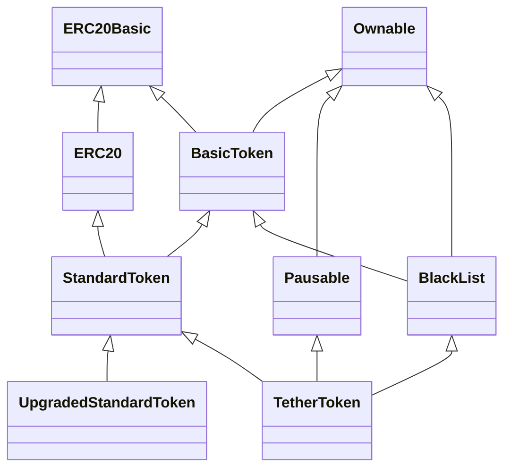

# `TetherToken.sol` アーキテクチャ

対象: [`source/TetherToken.sol`](../source/TetherToken.sol)（Solidity `^0.4.17`）。行番号はこのファイルを基準とする。

## 1. 全体概要

このファイルは、ERC-20 の基本操作を `BasicToken` と `StandardToken` に分け、`TetherToken` が Pause、Blacklist、発行・償還、移行機能を重ねた構成である。送金と委任送金は残高・手数料を処理し、管理者は供給量、手数料、停止状態などを操作できる。`deprecated` が有効になると、主要な ERC-20 操作は指定された移行先へ転送される。移行先の実装はこのファイルに含まれず、移行後の管理操作との整合性は別途確認が必要である（104–220、228–450行）。

## 2. 継承関係

矢印は「親 <|-- 子」。`SafeMath` は継承されず、`BasicToken` で `using SafeMath for uint` として使われる（[11–38行](../source/TetherToken.sol#L11)、[104–105行](../source/TetherToken.sol#L104)）。重複して見える `Ownable` への経路も、ソースに書かれた直接の継承をそのまま示す。

`UpgradedStandardToken` は移行先に要求する関数を宣言する型であり、`TetherToken` の親ではない（[307–315行](../source/TetherToken.sol#L307)）。

## 3. コントラクト・ライブラリ一覧

| 名前 | 役割と主要な関数（定義行） |
| --- | --- |
| `SafeMath` | `uint256` の算術補助。`mul`、`div`、`sub`、`add`（[11–38行](../source/TetherToken.sol#L11)）。 |
| `Ownable` | `owner` と `onlyOwner` による管理者制御。`Ownable`、`transferOwnership`（[45–72行](../source/TetherToken.sol#L45)）。 |
| `ERC20Basic` | 基本的な ERC-20 関数・イベントの宣言と `_totalSupply`。`totalSupply`、`balanceOf`、`transfer`（[81–87行](../source/TetherToken.sol#L81)）。 |
| `ERC20` | Allowance 関連の宣言。`allowance`、`transferFrom`、`approve`（[93–98行](../source/TetherToken.sol#L93)）。 |
| `BasicToken` | 残高、直接送金、手数料計算。`transfer`、`balanceOf`、`onlyPayloadSize`（[104–150行](../source/TetherToken.sol#L104)）。 |
| `StandardToken` | 委任送金と承認額の管理。`transferFrom`、`approve`、`allowance`（[159–220行](../source/TetherToken.sol#L159)）。 |
| `Pausable` | 停止状態と修飾子。`pause`、`unpause`、`whenNotPaused`、`whenPaused`（[228–266行](../source/TetherToken.sol#L228)）。 |
| `BlackList` | ブラックリスト管理と対象残高の消去。`addBlackList`、`removeBlackList`、`destroyBlackFunds`、状態取得関数（[268–305行](../source/TetherToken.sol#L268)）。 |
| `UpgradedStandardToken` | 移行先向け呼び出し口の宣言。`transferByLegacy`、`transferFromByLegacy`、`approveByLegacy`（[307–313行](../source/TetherToken.sol#L307)）。 |
| `TetherToken` | 最終的なトークン本体。コンストラクタ、ERC-20 操作の上書き、`deprecate`、`issue`、`redeem`、`setParams`（[315–450行](../source/TetherToken.sol#L315)）。 |

## 4. 主要機能の実装箇所

| 機能 | 実装箇所と読みどころ |
| --- | --- |
| トークン送金 | `TetherToken.transfer` が停止・送信元のブラックリストを確認し、通常時は `BasicToken.transfer` に進む。後者が手数料を計算し残高を更新する（[340–347行](../source/TetherToken.sol#L340)、[126–139行](../source/TetherToken.sol#L126)）。`transfer` 自体は ERC-20 系の操作、手数料・停止・ブラックリスト判定はこの実装の追加処理。 |
| Allowance | `StandardToken.approve` は既存の承認額が非ゼロなら、新しい非ゼロ値を拒否する。`transferFrom` は承認額を使い、`MAX_UINT` の場合は減額しない。`TetherToken` が両関数と `allowance` を上書きし、移行時には移行先へ振り分ける（[171–219行](../source/TetherToken.sol#L171)、[350–383行](../source/TetherToken.sol#L350)）。 |
| 発行・償還 | `TetherToken.issue` は owner の残高と `_totalSupply` を増やし、`redeem` は両方を減らす。いずれも `onlyOwner`（[406–427行](../source/TetherToken.sol#L406)）。初期供給量はコンストラクタで owner に割り当てる（[330–337行](../source/TetherToken.sol#L330)）。 |
| Pause | `Pausable.pause` / `unpause` が `paused` を変更する。`whenNotPaused` は `TetherToken.transfer` / `transferFrom` に付いている（[232–265行](../source/TetherToken.sol#L232)、[340–350行](../source/TetherToken.sol#L340)）。 |
| Blacklist | `BlackList.addBlackList` / `removeBlackList` が登録を変更し、`destroyBlackFunds` が登録済みアドレスの残高と `_totalSupply` を減らす。送金時のチェックは `TetherToken.transfer` の呼び出し元、`transferFrom` の `_from` に対して行う（[279–297行](../source/TetherToken.sol#L279)、[340–355行](../source/TetherToken.sol#L340)）。 |
| Upgrade / Deprecation | `TetherToken.deprecate` が `deprecated` と `upgradedAddress` を設定する。移行後は上書きされた `transfer`、`transferFrom`、`balanceOf`、`approve`、`allowance`、`totalSupply` が移行先を呼ぶ。移行先の追加関数は `UpgradedStandardToken` に宣言のみある（[307–313行](../source/TetherToken.sol#L307)、[339–400行](../source/TetherToken.sol#L339)）。 |
| Owner 権限 | `Ownable.onlyOwner` / `transferOwnership` が基盤。owner は `pause` / `unpause`、ブラックリスト操作、`deprecate`、`issue` / `redeem`、`setParams` を実行できる（[59–72行](../source/TetherToken.sol#L59)、[254–262行](../source/TetherToken.sol#L254)、[281–291行](../source/TetherToken.sol#L281)、[387–438行](../source/TetherToken.sol#L387)）。 |

## 5. 今後の調査ポイント

1. `TetherToken` の多重継承で、各 `super` 呼び出しは具体的にどの実装へ解決されるか（[315行](../source/TetherToken.sol#L315)、[345–355行](../source/TetherToken.sol#L345)）。
2. 移行先は `*ByLegacy` の呼び出し元検証や旧状態の引き継ぎをどう実装する必要があるか。移行先の実装はこのファイルにない（[307–313行](../source/TetherToken.sol#L307)、[339–400行](../source/TetherToken.sol#L339)）。
3. `deprecated` 後も旧コントラクトで動く `issue`、`redeem`、`destroyBlackFunds` と、移行先に転送される照会関数との関係はどうなるか（[291–297行](../source/TetherToken.sol#L291)、[394–427行](../source/TetherToken.sol#L394)）。
4. Pause と Blacklist はどの入口に適用され、`approve` や移行後の呼び出しにはどう影響するか（[340–375行](../source/TetherToken.sol#L340)）。
5. `setParams` で変更する手数料は、`transfer` / `transferFrom` の送付額・owner 残高・イベントにどう反映されるか（[126–139行](../source/TetherToken.sol#L126)、[171–192行](../source/TetherToken.sol#L171)、[429–438行](../source/TetherToken.sol#L429)）。

この資料はソースに記された構造と分岐を示す。デプロイ時の引数、現在の owner・手数料・停止・ブラックリスト・移行状態、および移行先の実装や状態は、このソースだけでは判断できない。
